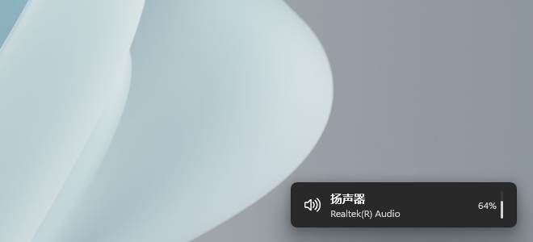
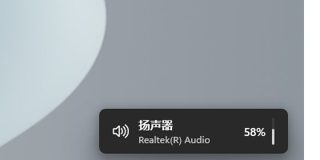
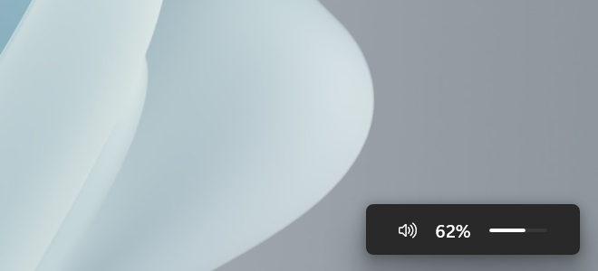
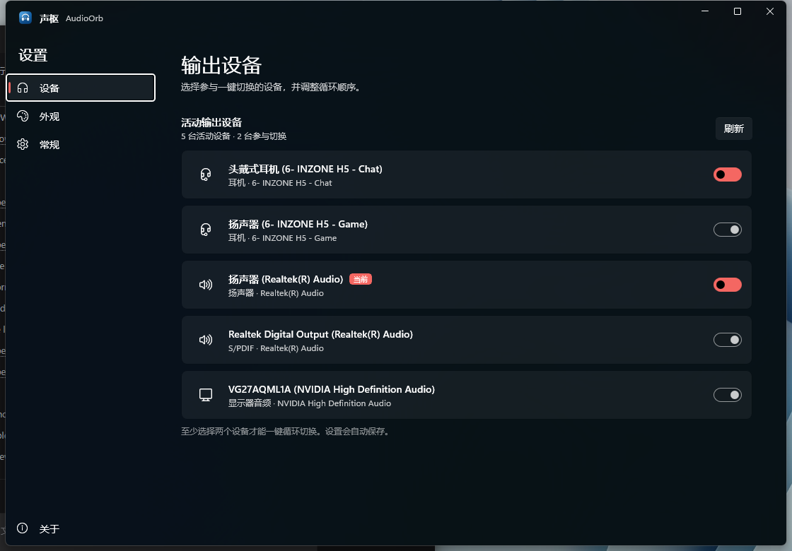
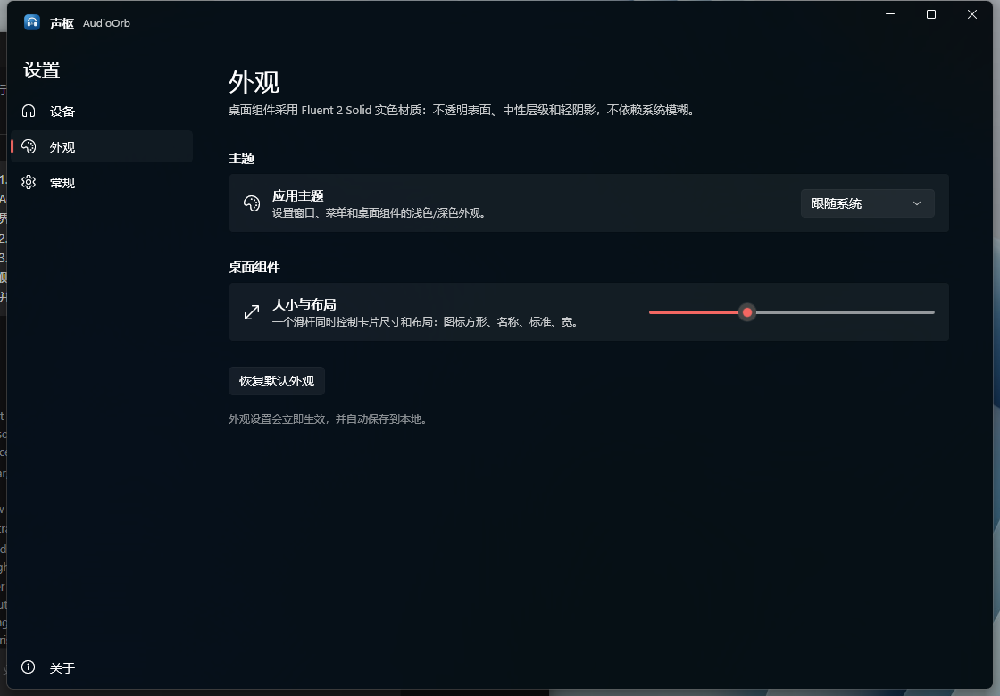
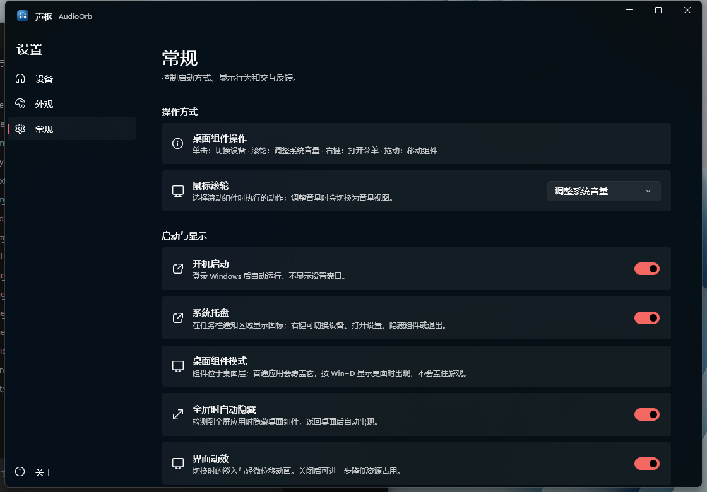
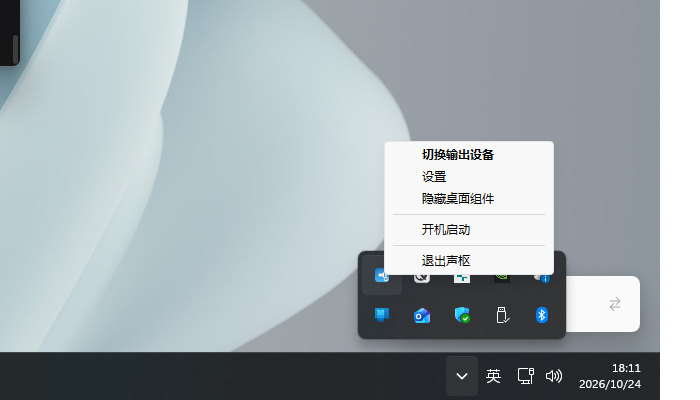

# 声枢 · AudioOrb

一个独立运行的 Windows 11 桌面组件，用于**一键切换当前声音输出设备**。为同时使用耳机和音响的玩家设计：不用再打开系统声音设置，回到桌面单击组件即可在预设设备之间立即切换。

它采用类似 **Windows 7 桌面小工具** 的行为：组件位于桌面层，普通应用会覆盖它，按 **Win+D** 显示桌面时出现；它不会覆盖游戏或其他窗口，也不会抢焦点。

外观遵循 **Fluent 2 的 Solid 材质**：不透明中性表面、8 px 圆角、外部 elevation 阴影；不使用球体、半透明假材质、强烈强调色、内部渐变或装饰性描边。



近距离样式：


同一滑杆控制四种尺寸与布局：

| 图标 | 紧凑 | 标准（竖向音量条） | 宽 |
| --- | --- | --- | --- |
|  |  |  |  |

滚轮音量模式（保持到点击或鼠标离开）：



## 功能

- **一键循环切换**：按设置中的顺序循环输出设备，耳机与音响来回切换。
- **直接显示当前设备**：名称与适配器随尺寸出现；紧凑档位用「音量 xx%」代替适配器名，彻底隐藏适配器。
- **系统原生线条图标**：使用 Segoe Fluent Icons；先读取 endpoint 的 form factor 与 PnP 容器，再决定扬声器 / 耳麦 / 耳机 / 显示器音频图标，不按设备名猜图标，也不使用 AI 匹配。
- **桌面组件行为**：位于桌面层，普通应用会覆盖；Win+D 或显示桌面时出现；不覆盖游戏。
- **Fluent 2 Solid 外观**：中性实色卡片、4 px 圆角、1 px Fluent contour、系统窗口阴影；无内部渐变、无自定义叠加阴影。
- **系统托盘**：原生通知区域图标；首次运行会把自身条目提升到可见托盘区。右键可打开设置、开机启动或退出。
- **Fluent 分层应用图标**：蓝色渐变 squircle、柔光与内阴影、带投影的白色耳机 / 均衡器标记。
- **一个滑杆四种布局**：图标方形 56 × 56、紧凑名称 168 px、标准 236 px（34 px 竖向音量条撑满内容高度）、宽 280 px；拖动时 tooltip 显示「图标 / 紧凑 / 标准 / 宽」。
- **右键操作视图**：组件右键后在原卡片内居中显示「设置」图标，鼠标移出卡片自动还原；不再弹出独立菜单。
- **滚轮默认调整音量**：在「常规」中可改为切换设备；音量视图保持到点击鼠标或鼠标离开卡片。标准/宽把图标、百分比、音量条作为等间距整体居中；紧凑档左右排列百分比和细条并隐藏喇叭；图标方形只显示百分比。
- **拖动与吸附**：拖到屏幕边缘附近自动吸附；位置持久化。
- **轻量动效**：设备切换使用 80 ms 渐隐 + 150 ms 渐显的纯透明度交叉过渡，不位移、不缩放，不阻塞点击。
- **全屏自动隐藏**：检测到游戏/全屏应用时隐藏，返回桌面后恢复（可关闭）。
- **开机启动**：写入当前用户 `Run` 项；移动程序目录后自动同步路径。
- **设置界面**：选择参与切换的设备、主题、大小与布局（四档滑杆）、滚轮行为、动效、位置重置；使用 Mica 背景，控件按 Windows 设置风格右对齐，左侧 18 px 图标不再使用圆角底板；设备行只保留启用开关。
- **单实例**：重复启动会唤起已有实例的设置窗口，不会产生多个桌面组件。
- **本地优先**：不收集、不上传数据，配置与日志只保存在本机。

## 设置界面

| 设备 | 外观 |
| --- | --- |
|  |  |

| 常规 |
| --- |
|  |

| 系统托盘菜单（Windows 原生） |
| --- |
|  |

## 使用

1. 解压 `AudioOrb-win-x64.zip`，运行 `AudioOrb.exe`。
2. 首次运行会打开设置，进入「设备」，勾选耳机和音响两台设备。
3. 按 **Win+D** 回到桌面，单击桌面组件切换；滚轮循环；右键显示设置/关闭；拖动移动。
4. 托盘图标：左键打开设置，右键可打开设置、开机启动或退出。
5. 在「常规」中按需开启开机启动、托盘图标、全屏隐藏等选项。

默认位置在屏幕右下角、任务栏上方。设置保存在：

```text
%LOCALAPPDATA%\AudioOrb\settings.json
```

日志保存在：

```text
%LOCALAPPDATA%\AudioOrb\logs\app.log
```

## 系统要求

- Windows 11（推荐）。Windows 10 1809+ 理论上可运行，但界面按 Windows 11 设计。
- x64 处理器。
- 发布包是**自包含**的，不需要预装 .NET 或 Windows App Runtime。

## 从源码构建

需要 [.NET 8 SDK](https://dotnet.microsoft.com/download/dotnet/8.0) 和 Windows 10/11 SDK 引用（由 NuGet 自动还原）。

```powershell
# 构建（解决方案会把 Any CPU 映射到 x64）
dotnet build .\AudioOrb.sln -c Debug

# 构建并启动
powershell -ExecutionPolicy Bypass -File .\scripts\run.ps1

# 发布自包含 x64 目录与 zip
powershell -ExecutionPolicy Bypass -File .\scripts\publish.ps1
```

发布输出：

```text
dist\AudioOrb-win-x64\
dist\AudioOrb-win-x64.zip
```

发布脚本会移除 Windows App SDK 1.8 自包含输出中未使用的 AI / WebView2 / Widgets 负载，把目录从约 208 MB 控制到约 160 MB。程序本身不使用这些组件。

## VS Code

工程已包含 `.vscode/` 配置：

- 打开仓库根目录，安装推荐扩展：**C# Dev Kit / C# / PowerShell**。
- `Ctrl+Shift+B` 执行默认构建任务。
- `F5` 使用 `.vscode/launch.json` 启动调试（输出目录中的 `AudioOrb.exe`）。
- `Terminal > Run Task > publish` 执行发布。

首次打开前请确认 `dotnet --version` 能返回 8.x。如果 VS Code 没有识别 SDK，重新登录或重启 VS Code，让用户级 PATH 生效。

## 项目结构

```text
src/
  AudioOrb/                 WinUI 3 桌面应用（桌面卡片、设置、托盘行为）
  AudioSourceSelect.Core/   无 UI 的 Core Audio 枚举/切换/通知/设置存储
tests/
  AudioProbe/               控制台探针：枚举、切换、往返测试、设置归一化
scripts/
  build.ps1 / run.ps1 / publish.ps1 / install.ps1
  push-github.ps1          登录 gh 后一键建仓库/推送/发布 Release
docs/
  DEVELOPMENT.md / ARCHITECTURE.md / PERFORMANCE.md
```

## GitHub 存档

仓库已完成本地初始化、首次提交和 `v1.0.0` 标签。登录 GitHub CLI 后执行：

```powershell
gh auth login --hostname github.com --git-protocol https --web
powershell -ExecutionPolicy Bypass -File .\scripts\push-github.ps1
```

脚本会：

1. 读取当前 GitHub 账号作为提交作者；
2. 创建公开仓库 `AudioOrb`（或使用已有 origin）；
3. 推送 `main` 和 `v1.0.0` 标签；
4. 若存在 `dist\AudioOrb-win-x64.zip`，创建 `v1.0.0` Release 并上传 zip。

默认公开；需要私有仓库时：

```powershell
powershell -ExecutionPolicy Bypass -File .\scripts\push-github.ps1 -Visibility Private
```

## 技术实现

- **C# / .NET 8 / WinUI 3 / Windows App SDK 1.8**
- **Windows Core Audio**：`IMMDeviceEnumerator`、`IMMDevice`、`IPropertyStore`、`IMMNotificationClient`
- **默认设备切换**：`IPolicyConfig::SetDefaultEndpoint`（Console / Multimedia / Communications 三个角色）
- 设备变化完全事件驱动；空闲时不轮询音频状态。
- 桌面组件使用无激活分层窗口，位于桌面层；仅在桌面/任务栏为前台时加入 topmost 带以通过 Win+D，应用获得焦点后立即降回普通窗口之下。
- 设置页在支持时使用 Mica（带可读性 scrim）；桌面组件按 Fluent 2 Solid 材质实现：`#292929` / `#FAFAFA` 实色表面 + 1 px 内部 contour + 系统窗口阴影，不再叠加自定义阴影。
- 系统托盘使用原生 `Shell_NotifyIcon` + Win32 菜单；菜单由 Windows 11 原生渲染，具体材质与圆角由系统主题决定。

更详细的设计与坑位记录见 [docs/ARCHITECTURE.md](docs/ARCHITECTURE.md)。

## 性能

- 空闲 CPU：约 **0.08%**（20 秒采样，桌面组件静止、设置关闭）。
- 工作集：约 **140–170 MB**；私有内存约 **95–125 MB**。
- 这是 WinUI 3 / Windows App SDK 的运行时基线，主要来自 `Microsoft.ui.xaml.dll`、.NET 运行时和合成器。项目本身没有音频轮询、后台服务或常驻动画。

详见 [docs/PERFORMANCE.md](docs/PERFORMANCE.md)。

## 已知限制

- **系统级 Acrylic/Mica 实时模糊**：已尝试非分层窗口、正常窗口边框、`MicaBackdrop`、`DesktopAcrylicController` 和直接 DWM `SYSTEMBACKDROP_TYPE`；WinUI 3 对这个无标题栏工具窗口仍回退为实色。Hover 不会让无激活窗口获得真正焦点，强制激活后材质仍不出现，因此没有在 hover 时切换材质。按照 [Fluent 2 Material](https://fluent2.microsoft.design/material) 的降级原则，组件使用 **Solid 材质**，用实色和 elevation 建立层级。
- `IPolicyConfig` 是 Windows 未公开的音频策略接口；主流 Windows 10/11 版本可用，但未来系统更新可能改变行为。
- 部分独占全屏游戏或带反作弊覆盖层的游戏可能无法显示/检测；桌面组件默认会被全屏应用覆盖，可在设置中关闭“全屏时自动隐藏”。
- 当前只构建 x64。ARM64 需要额外发布目标。

## 开发状态

- 版本：`1.0.0`
- 已通过真实设备往返切换测试（扬声器 ↔ INZONE H5 Game）。
- 已验证：桌面层显示、Win+D 出现、应用覆盖、单击切换、滚轮、右键操作视图、拖动吸附、全屏隐藏、设置页、开机启动、单实例、主题切换、Fluent 2 Solid 深浅色外观、发布包独立启动。

## License

MIT
